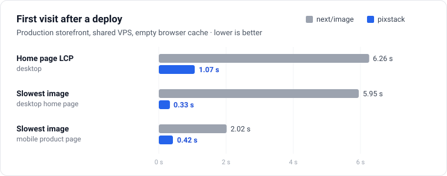
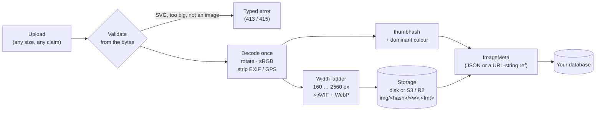
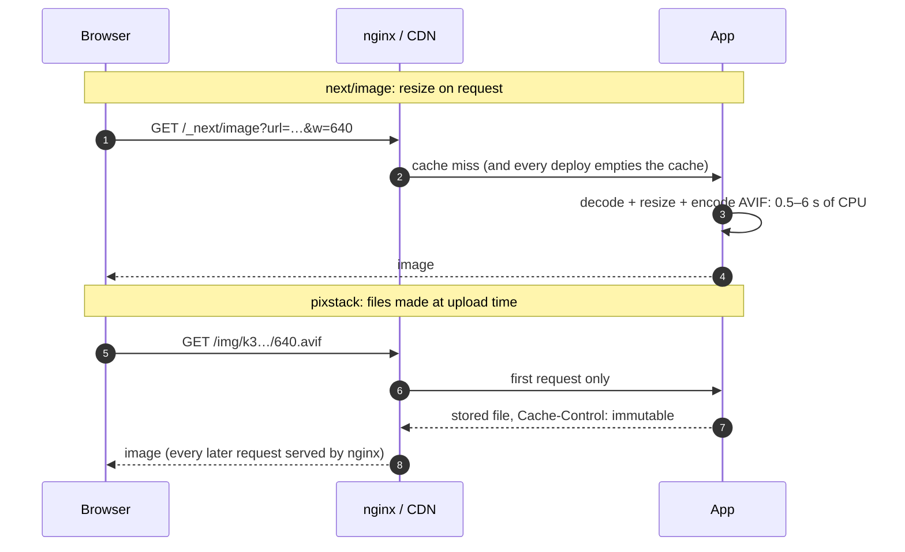

# pixstack

**Cloudinary-quality images for self-hosted apps.** Upload once, and pixstack validates the file, compresses it to AVIF + WebP at a ladder of widths, stores the results on disk or S3, serves them with forever-caching, and renders them with `srcset`, intrinsic size and an instant thumbhash placeholder.

No SaaS, no image CDN bill, and no CPU spent on the request path.

> Status: **0.3, pre-release.** The API may change before 1.0. See [docs/roadmap.md](docs/roadmap.md).

## Results

Measured on a production storefront (Next.js on a shared VPS), migrated from `next/image` to pixstack on the same day, with the same catalogue and an empty browser cache:



| | `next/image` | pixstack |
|---|---|---|
| Home page LCP, first visit after a deploy (desktop) | 6.26 s | **1.07 s** |
| Slowest image on that page | 5.95 s | **0.33 s** |
| Image bytes per page | 10–68 KB | same ±13 % |
| Visual difference (pixel diff, 5 pages × 2 devices) | | none |
| Image encodes while serving pages | every cache miss, again after every deploy | **zero** |

<sub>Method: Chrome via Playwright, new browser context per page (empty cache), desktop 1440 px and mobile 412 px at 2.6× pixel density. On the home page the LCP element is the hero photo in both versions. Network variance from the test machine is about ±0.3 s. "Slowest image" is the longest time-to-first-byte of any image on the page.</sub>

On a single image: a 2.1 MB PNG hero becomes **88 KB** of AVIF at full width, **6 KB** at 320 px, plus a **25-byte** placeholder.

The full write-up, with method and pitfalls, is in [docs/adoption.md](docs/adoption.md).

## How it works



Every file name is derived from the image's content hash, so a URL never changes meaning. That makes the rest simple:



## Why it's built this way

- **Encode at upload, not on request.** Visitors never wait for an encoder. Deploys and restarts don't empty anything. The public endpoint never decodes untrusted input (the Next.js image optimizer had several critical CVEs in 2026).
- **Content-addressed, immutable URLs.** Cache forever in the browser, nginx and the CDN, and never purge. Identical uploads are stored once.
- **Everything the page needs travels with the image.** Width, height, the variant list and a placeholder sit in one small `ImageMeta`, so `` renders `srcset`, intrinsic size (no layout shift) and a blurred preview with no extra request.
- **Fits existing apps.** If your images live in `imageUrl` string columns, an *ImageRef* packs the meta into a normal URL: no schema migration, and old `` code keeps working.
- **Safe by default.** Format detected from bytes, pixel and size limits before decoding, metadata always stripped, SVG refused, originals never public, only known types served with `nosniff`.

## Install

```sh
pnpm add pixstack sharp
```

`sharp` is needed only where you ingest (the server). `react` is needed only for `pixstack/react`.

## Quick start (Next.js App Router)

```ts
// lib/images.ts
import { createImageProcessor } from "pixstack";
import { diskStorage } from "pixstack/storage";

export const storage = diskStorage({ root: process.env.UPLOAD_DIR ?? "./uploads" });
export const images = createImageProcessor({ storage });
```

```ts
// app/api/upload/route.ts
import { isPixstackError } from "pixstack";
import { images } from "@/lib/images";

export async function POST(req: Request) {
  // …authenticate first…
  const file = (await req.formData()).get("file");
  if (!(file instanceof Blob)) return Response.json({ error: "No file" }, { status: 400 });
  try {
    const meta = await images.ingest(file);
    await db.product.update({ where: { id }, data: { image: meta } }); // a Json column
    return Response.json(meta);
  } catch (err) {
    if (isPixstackError(err)) return Response.json({ error: err.code }, { status: err.status });
    throw err;
  }
}
```

```ts
// app/img/[...key]/route.ts — or skip this and let nginx serve /img/ (below)
import { createImageHandler } from "pixstack/server";
import { storage } from "@/lib/images";

const handler = createImageHandler({ storage });
export { handler as GET, handler as HEAD };
```

```tsx
// anywhere
import { Img } from "pixstack/react";


   {/* the LCP image */}
```

This renders:

```html
<picture>
  <source type="image/avif" srcset="/img/k3…/320.avif 320w, /img/k3…/640.avif 640w, …" sizes="…">
  
</picture>
```

## Already have `imageUrl` string columns? Use refs

If you don't want a JSON column, store an **ImageRef** instead. It's a normal image URL that also carries the meta:

```ts
import { toImageRef } from "pixstack/meta";

const ref = toImageRef(await images.ingest(file));
// "/img/k3…/1280.webp?pv=1&w=1945&h=809&l=320.640.960.1280.1920&f=aw&s=j&c=a38668&t=…"
await db.category.update({ where: { id }, data: { imageUrl: ref } });

  // same output as with the meta
```

Old code that does `` keeps working, because the ref points at a real 1280px WebP. Use `isImageRef(url)` to tell refs apart from legacy URLs while you migrate.

> **Identical files share one URL.** pixstack names files by their content, so the same photo uploaded twice (say, one shot used for two colour variants) gives the same ref. Don't use the image URL alone as a React `key`, and don't delete stored files when one record drops a ref: another record may still use it. Reclaim unused files with `sweep()` instead:
>
> ```ts
> const ids = (await db.productImage.findMany({ select: { url: true } })).map((r) => parseImageRef(r.url)?.id);
> const { removed, bytes } = await images.sweep({ keep: ids.filter(Boolean) as string[], dryRun: true }); // look first
> ```
>
> Gather ids from **every** column that holds images. Images touched in the last 24 h are kept, so uploads whose record isn't saved yet survive.

## Store on S3 / Cloudflare R2

```ts
import { S3Client } from "@aws-sdk/client-s3";
import { s3Storage } from "pixstack/storage/s3";

const storage = s3Storage({
  client: new S3Client({
    region: "auto",
    endpoint: `https://${process.env.R2_ACCOUNT_ID}.r2.cloudflarestorage.com`,
    credentials: { accessKeyId: process.env.R2_KEY!, secretAccessKey: process.env.R2_SECRET! },
  }),
  bucket: "media",
  publicBaseUrl: "https://media.example.com", // custom domain on the bucket
});
//  storage.publicUrl!(key)} … /> serves straight from the CDN
```

Variants are written with `Cache-Control: public, max-age=31536000, immutable`, originals with `private, no-store`. Keep `orig/` out of the public bucket domain: with R2, use a separate bucket or a WAF rule.

## Serve with nginx (recommended)

Public variants are plain files, so let nginx send them and keep Node out of the path:

```nginx
location /img/ {
    alias /data/uploads/img/;
    expires max;
    add_header Cache-Control "public, max-age=31536000, immutable";
    add_header X-Content-Type-Options nosniff;
    location ~ /meta\.json$ { return 404; }
}
# Never alias /data/uploads/orig/. Originals are private (see signed URLs).
```

For **private** images, keep the access check in your app and let nginx stream the bytes:

```ts
createImageHandler({ storage, secret: process.env.IMAGE_SECRET, accel: { prefix: "/_pixstack" } });
```

```nginx
location /_pixstack/ { internal; alias /data/uploads/; }
```

## What `ingest()` does

1. Detects the format from the **bytes** (never trusts the MIME type or file name). Accepts JPEG, PNG, WebP, AVIF, HEIC, GIF and TIFF. SVG is refused unless `allowSvg`, and then it is rasterised.
2. Enforces `maxBytes` (25 MB), `maxPixels` (50 MP) and `maxDimension` (12 000 px) from the header, before decoding.
3. Applies EXIF orientation, converts to sRGB and **strips all metadata** (GPS included).
4. Hashes the original into an id. Re-uploading the same file returns the existing meta.
5. Encodes widths `160 … 2560` in ~1.25–1.5× steps (never upscaling) as AVIF q52 and WebP q78. Transparent images get higher alpha quality, and small PNG art is encoded losslessly.
6. Computes a [thumbhash](https://evanw.github.io/thumbhash/) and the dominant colour.
7. Stores `img/<id>/<w>.<fmt>` (public), `orig/<id>.<ext>` (private, for `reprocess()`) and `img/<id>/meta.json`.
8. Returns an `ImageMeta` (~2.5 KB of JSON, or a ~150-character ImageRef string) that you save next to your record.

### Faster uploads: AVIF in the background

AVIF compresses best but encodes slowest. Defer it so the upload returns 4–5× sooner:

```ts
import { after } from "next/server";

const meta = await images.ingest(file, { defer: ["avif"] }); // WebP ready, meta.pending = ["avif"]
await db.product.update({ where: { id }, data: { image: meta } });
after(async () => {
  const full = await images.complete(meta); // adds AVIF from the kept original
  await db.product.update({ where: { id }, data: { image: full } });
});
```

Until `complete()` finishes, `` serves WebP only. `complete()` is idempotent and reads the original from storage, so it also works from a queue worker or after a restart.

Errors are `PixstackError`s with a `code` (`TOO_LARGE`, `TOO_MANY_PIXELS`, `UNSUPPORTED_FORMAT`, `SVG_NOT_ALLOWED`, …) and a suggested HTTP `status`.

## Modules

| Import | For |
|---|---|
| `pixstack` | `createImageProcessor`: `ingest`, `complete`, `reprocess`, `remove`, `sweep`, `getMeta` |
| `pixstack/storage` | `diskStorage`, `memoryStorage`, the `Storage` interface |
| `pixstack/storage/s3` | `s3Storage` for AWS S3, Cloudflare R2, MinIO (needs `@aws-sdk/client-s3`) |
| `pixstack/server` | `createImageHandler` (Web `Request → Response`; works in Next, Hono, Bun, Deno), `signUrl` |
| `pixstack/react` | ``, `getImageProps`, `placeholderStyle` |
| `pixstack/meta` | `ImageMeta` types, refs, `srcSet`, `pickVariant`, `widthLadder` (no dependencies) |
| `pixstack/node` | `toNodeHandler`: the image handler on `node:http`, Express, Connect, Fastify |
| `pixstack/next` | A `next/image` loader for refs, for code that keeps `<Image>` |
| `pixstack/client` | `prepareUpload`: shrink photos in the browser before upload; `targetSize` for Expo |
| `pixstack` (CLI) | `ingest`, `complete`, `reprocess`, `audit`, `sweep`, `ref` on disk or S3 storage |

### Express / Fastify

```ts
import { toNodeHandler } from "pixstack/node";
const node = toNodeHandler(createImageHandler({ storage }));
app.use(node); // Express: unknown keys fall through to next()
fastify.get("/img/*", (req, reply) => { reply.hijack(); return node(req.raw, reply.raw); });
```

### Keep `next/image`

```ts
// image-loader.ts
export { default } from "pixstack/next";
// next.config.ts
images: { loader: "custom", loaderFile: "./image-loader.ts" }
```

Refs then map each width to a stored WebP (`createNextLoader({ format: "avif" })` for AVIF); other URLs get `?w=`. `` stays the better choice where you can use it: it serves AVIF with a WebP fallback and draws the placeholder.

### Shrink before upload

```ts
import { prepareUpload } from "pixstack/client";
const { file } = await prepareUpload(input.files[0]); // ≤ 2560 px, EXIF dropped, untouched when nothing is gained
```

In Expo, pass `targetSize(asset.width, asset.height)` to `expo-image-manipulator`. The server validates and re-encodes everything anyway: this only saves upload time.

### CLI

```sh
npx pixstack ingest ./uploads --root ./media > refs.jsonl   # backfill: one {file,id,ref} line per image
npx pixstack audit --root ./media                           # missing variants, stray files, pending formats
npx pixstack complete --root ./media                        # finish formats left by `defer`
npx pixstack sweep --keep ids-in-use.txt --root ./media     # dry run; add --yes to delete
```

`--s3-bucket <name>` (with `--s3-endpoint` for R2/MinIO) works instead of `--root`.

## Docs

- [Architecture](docs/architecture.md): pipeline, modules, storage layout, serving modes
- [Design](docs/design.md): `ImageMeta`, defaults and why, API, decisions
- [Adoption guide](docs/adoption.md): migrating an existing app (string image columns, `next/image`, Docker)
- [Roadmap](docs/roadmap.md): what's done and what's next
- [Changelog](CHANGELOG.md) · [Security](SECURITY.md)
- Examples: [Next.js App Router](examples/next) · [Hono](examples/hono)

## Development

```sh
pnpm install
pnpm check   # privacy check, typecheck, tests, build, dist checks
pnpm bench <dir-of-photos>   # bytes and SSIM per format/quality
```

## License

MIT
